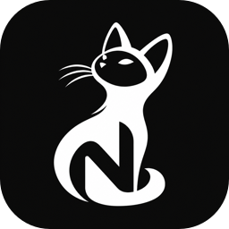

<p align="center">
  
</p>

<h1 align="center">NimoteHost — Tasks, terminals and coding agents over SSH</h1>

<p align="center">English · <a href="README.zh-CN.md">简体中文</a></p>

<p align="center">
  <strong>The host-side companion to NimoteCode, keeping tasks, terminals and coding agent sessions running after clients disconnect.</strong><br>
  A standalone CLI and desktop manager for Linux, macOS and Windows.
</p>

<p align="center"><sub>Persistent Tasks&nbsp;&nbsp;•&nbsp;&nbsp;Terminal Sessions&nbsp;&nbsp;•&nbsp;&nbsp;Agent Approvals&nbsp;&nbsp;•&nbsp;&nbsp;Community Plugins</sub></p>

<p align="center"><sub>
  <a href="#start-here">Quick start</a> ·
  <a href="#one-command-installation">Install</a> ·
  <a href="#build-and-run">Build from source</a> ·
  <a href="#desktop-edition-fyne">Desktop edition</a> ·
  <a href="SECURITY.md">Security</a>
</sub></p>

<p align="center"><sub>2.4.0 development preview · Open source under Apache-2.0</sub></p>

---

## Overview

NimoteHost is primarily designed to work with [NimoteCode](https://github.com/mobiledevloperlab/nimotecode),
providing the task, terminal and coding agent backend for its Host workspace. It is
a standalone Go runtime accessed over an existing authenticated SSH connection. Host listens only on loopback and authenticates every RPC request.
No Nimote account, control plane or public relay is required.

Build targets include Linux/macOS/Windows amd64 and arm64 CLI and desktop editions,
plus Linux/Windows 32-bit x86 (386) CLIs. Full native-platform and mobile/Agent
acceptance remains outstanding; see [pending functionality](docs/pending.md).

Current functionality: [completed](docs/completed.md) and [pending](docs/pending.md).
Hardening decisions and verification: [audit](docs/host-hardening.md) and [test results](docs/host-hardening-tests.md).

## With NimoteCode or on its own

Install and start NimoteHost on your host, then connect NimoteCode over SSH as the
same OS user to use the sessions, output and Agent approvals available in compatible
versions. The client probes the protocol and capabilities before enabling features;
availability depends on both versions, host configuration and installed Agents.

Running NimoteHost does not require the NimoteCode client. Other users can build
and deploy it, use the desktop manager, or integrate scripts and their own clients
through these interfaces:

- `nimotehost rpc`: accepts a JSON request on stdin and calls the authenticated local API.
- `nimotehost rpc-stream`: multiplexes JSONL requests over one SSH exec channel after stream-protocol negotiation.
- `nimotehost mcp`: serves compatible MCP clients; read-only by default, with writes explicitly enabled.

See [features and protocols](docs/completed.md) and the
[client compatibility table](docs/host-hardening.md#client-compatibility).
The [Go client package](pkg/hostclient) provides capability negotiation, structured
errors and a command transport using stdin. See the [integration guide](docs/client-api.md)
and [runnable example](examples/host-client/main.go). `pkg/pluginsdk` is separate
and intended for community plugins.

Host executes commands as its OS user by default. Connecting through an ordinary
SSH login for that user carries that account's authority. Multi-user deployments
need their own account and isolation boundaries; see [Security](SECURITY.md).

## Start here

| What you want to do | Where to go |
| --- | --- |
| Download the CLI or desktop edition | [GitHub Releases](https://github.com/mobiledevloperlab/nimotehost/releases) · [Platforms and artifacts](#github-build-artifacts) |
| Install and start the background service | [One-command installation](#one-command-installation) |
| Build the CLI from source | [Build and run](#build-and-run) |
| Use the graphical interface | [Desktop edition](#desktop-edition-fyne) |
| Understand features and security boundaries | [Implemented functionality](docs/completed.md) · [Security policy](SECURITY.md) |

Tasks continue after clients disconnect; restarting Host or the OS does not restore
task processes. Install and configure SSH and Agent CLIs such as Codex, Claude Code
and OpenCode separately.

## Deploy a prebuilt release

End users do not need Go. See [implemented installation and service behavior](docs/completed.md#installation-and-services)
for bundle verification, stable installation paths and the per-user service commands.

## One-command installation

From the Host source root (Go 1.26.5+) or an extracted distribution (no Go needed):

```sh
sh scripts/install.sh
```

For source installation, `go run ./tools/install` also works across platforms.
Windows PowerShell: `.\scripts\install.ps1`. The installer verifies the full bundle,
installs to a fixed user directory, starts the service and checks readiness.
Repeating a healthy installation does not restart it. Updates preserve the old
bundle and refuse to interrupt active tasks. See [implemented installation behavior](docs/completed.md#installation-and-services)
for prerequisites, older preview upgrades and recovery.

## Build and run

Install Go 1.26.5 or later. Clone this repository and run from its root:

```sh
go run ./tools/build
```

This works from PowerShell as well as Unix shells. Run the generated binary at
`dist/<os>-<arch>/nimotehost` (`nimotehost.exe` on Windows):

```sh
./dist/linux-amd64/nimotehost start
```

For other targets or a versioned distribution:

```sh
go run ./tools/build -os windows -arch arm64 -version 2.4.0
```

The complete distribution includes current bilingual feature documentation, licenses,
a module manifest, build metadata and SHA256SUMS. Builds also produce a versioned
`.tar.gz` (Linux/macOS) or `.zip` (Windows) and an adjacent `.sha256`. A Bash wrapper, `./scripts/build-host.sh <os> <arch> [version]`,
is also available. Preserve the entire distribution when sharing binaries.

Put the binary in a fixed location on the remote user's PATH, then use
`nimotehost install` to start a per-user background service and wait until ready, or `nimotehost start`
for foreground operation. This does not configure SSH or install Agent CLIs.
Tasks outlive client disconnection; Host/OS restart marks unfinished sessions
interrupted and does not resurrect their processes.

## Desktop edition (Fyne)

The public executable and package name is now `nimotehost` (`NimoteHost` in the GUI).
Close the previous GUI before running `nimotehost setup` from a complete bundle.
Setup migrates the previous state directory only after an authenticated idle shutdown;
active sessions and conflicting state directories block migration. Credentials, Host
identity and records are retained, and failed installation restores the previous service.
The GUI imports the previous language/theme preferences once. On Unix the old SSH
command and absolute executable path forward to the new CLI, with the old executable
retained for recovery. On Windows, update any manually configured absolute SSH forced
command to `nimotehost.exe`. Only upgrade compatibility retains the old spelling.

The CLI and desktop manager share the existing Go Host and authenticated loopback
RPC. Desktop dependencies live in `cmd/nimotehost-gui/go.mod`; a CLI build does
not compile or download Fyne. No mobile protocol or public transport is changed.

```sh
# Native desktop SDK / C compiler required; also builds the CLI distribution
go run ./tools/build -gui -version 2.4.0
# Or: make desktop
```

Downloads are named `nimotehost-<version>-<os>-<arch>` (CLI) and
`nimotehost-gui-<version>-<os>-<arch>` (desktop, including CLI). Desktop archives
include dependency licenses, GUI-MODULES.json and checksums. Run the existing
installer from the extracted desktop bundle to copy the complete bundle to a stable
path and start the login service. Then open the installed `nimotehost-gui.exe`
(Windows), `NimoteHost.app` (macOS), or `nimotehost-gui` (Linux).
Unix installation: `~/.local/share/nimotehost`; Windows: `%LOCALAPPDATA%/NimoteHost`.
The Linux `.desktop` file assumes the installed GUI directory is on PATH; copy it
to `~/.local/share/applications` or set its Exec to the absolute GUI path.

You can also run directly from `dist/gui-<os>-<arch>`; keep that directory stable
when enabling login startup. Start attaches to a running Host; otherwise it uses
the installed service or starts an independent background CLI. Closing/quitting
GUI keeps Host and its sessions alive. Stop/restart explicitly ends Host tasks.
Linux defaults to normal window close because trays are desktop-dependent; enable
tray use in Settings only with a working tray. Windows/macOS close hides to tray.

The four main pages are Overview, Sessions, Devices and Settings. Overview shows
service status and one primary action; Sessions uses readable names, search and
status filters, with saved conversations under Past conversations. Settings groups
general preferences, local service and about information. Local service controls
include start/stop, port validation, unsaved change status and a fixed save bar.
Silver-gray light and dark appearances use consistent rounded surfaces and spacing.
Changing the display language preserves configuration drafts and session filters.
Conversations can expand into a reading view with selectable text and copying;
diagnostics and logs have large tabbed viewports in Help & diagnostics. About
explains the NimoteCode companion workflow, local data, access and agent privacy,
and appearance. Shortcuts use Cmd on macOS or Ctrl on Windows/Linux: 1–4 switch
pages, comma opens Settings, F searches sessions, and R refreshes status. Command and file-change approvals still show their actual
content before you decide.

Choose English, Simplified Chinese, Spanish, Japanese, Korean or Russian in Settings → Language.
English is the default; language changes apply immediately and persist without
restarting Host. Fyne uses installed system fonts; Linux needs suitable CJK fonts
(such as `fonts-noto-cjk`) for Chinese, Japanese and Korean.

Settings share `config.json` in the existing OS user configuration directory under
`nimotehost`. Defaults remain port 47831 and log level info; changes require Host
stopped. The port always binds 127.0.0.1, **not LAN IPs**. SSH remains externally
managed. Runtime logs are owner-private and bounded at 64 KiB; diagnostic exports
exclude logs, credentials, command arguments and session contents. GUI preferences
(language, theme, Linux tray) are stored separately by Fyne.

Sessions and structured Agent approvals use live existing RPC data. Devices manages restricted read-only identities and revocation; unrestricted
SSH accounts remain outside device isolation. SSH health is reported as externally managed rather than guessed.
See [desktop audit, build prerequisites and limits](docs/completed.md#desktop-architecture-audit)
and [remaining acceptance](docs/pending.md).

## Interfaces

- Authenticated SSH exec: `nimotehost rpc` or `rpc-encoded`.
- Local authenticated HTTP RPC: task/session lifecycle, terminal input/resize,
  byte-offset output replay and persistent state events.
- Stdio MCP: read-only by default; writes require explicit local opt-in.
- Agent terminal adapters: installed Codex, Claude Code and OpenCode CLIs.
  Structured app-server/ACP approvals and native history are implemented; runtime
  capabilities and broader real-agent acceptance remain separate.

Read [implemented functionality and protocol](docs/completed.md),
[pending functionality and acceptance](docs/pending.md),
[contribution guidelines](CONTRIBUTING.md) and [security policy](SECURITY.md).

## GitHub build artifacts

[Host CI](.github/workflows/ci.yml) runs tests, clean-source checks, eight CLI target
builds and six native desktop target builds on pull requests and pushes to `master`
or `main`. Run it manually with `cli`, `gui`, or `both`. Download build outputs from
the run's **Artifacts** section. Pushing a `v*` tag starts both builds. The CLI packages
and source archive go live after the CLI checks pass. The desktop packages are added
to the same GitHub Release after all six desktop builds pass. Adding desktop packages
requires immutable releases to be disabled in the repository settings.

| Platform | CLI | Desktop |
| --- | --- | --- |
| macOS | x64, ARM64 | x64, ARM64 |
| Linux | x86 (386), x64, ARM64 | x64, ARM64 |
| Windows | x86 (386), x64, ARM64 | x64, ARM64 |

Desktop packages use native runners and include the CLI, dependency licenses and
SHA-256 checksums. Linux desktop targets glibc 2.35 or newer. ARM means ARM64;
32-bit ARM and 32-bit desktop packages are not supported. macOS packages are unsigned
and not notarized. See the [release audit](OPEN_SOURCE_REVIEW.md) before publishing.

`amd64` means 64-bit Intel/AMD x86; `arm64` means 64-bit ARM (including Apple
Silicon). `386` is legacy 32-bit x86, CLI only. macOS has no 32-bit build target.
32-bit ARM is outside this distribution matrix. CLI and GUI in a bundle must match
the target architecture. GUI CI uses six native runners with the required desktop
SDKs; cross-building a CLI alone does not verify the GUI or interactive behavior.
On Windows ARM64, use MSYS2 CLANGARM64 (`CC=clang`, `CXX=clang++`), rather than the
x64 MinGW compiler. See [MSYS2 ARM64](https://www.msys2.org/docs/arm64/).


## Agent upstream monitoring

The [compatibility workflow](.github/workflows/agent-compatibility.yml) checks upstream releases
every six hours (00:23, 06:23, 12:23 and 18:23 UTC). On its first run or a version change,
it temporarily installs exact versions of Codex, OpenCode, the Claude ACP adapter and Claude Code,
checks real structured session initialization, runs existing Host Agent/protocol/approval regressions, and exports
Codex JSON Schema. It sends no prompts and makes no model calls. Claude Agent SDK, ACP SDK,
and ACP Go SDK releases are also watched without automatically updating project dependencies.

Push to the repository's default branch, enable Actions and Issues, and manually run
`Agent compatibility monitor` to establish a baseline. Subscribe to the issue it creates;
subsequent updates post comments, with email delivery controlled by your GitHub notification settings.
A failed version snapshot is retried once; use the manual `force` option for further retries.
Unchanged polls do not install CLIs or run tests. No extra secrets are needed: the workflow uses
the built-in `GITHUB_TOKEN`, with issue write permission limited to the reporting job.

A pass covers Linux startup and existing protocol fixtures; full approval, streaming and resume
acceptance still requires model tests. Failures can also be caused by installation, authentication
or networking. SDK latest versions are watch signals; checks use resolved adapter dependencies
and the repository's pinned Go SDK. Schema artifacts are exported without semantic diffing.
Logs and schemas expire after seven days. Scheduled runs can be delayed, and free usage is shared
across the account: configure an Actions budget with usage stopping in GitHub Billing to control
costs. The workflow cannot guarantee zero charges. Preserve the issue's hidden state markers.

## Development

```sh
go test -mod=readonly -race ./...
go vet ./...
```

`make build` and `make check` are optional shortcuts. The standalone CI covers
three native platforms and eight CLI cross-build targets. Tests do not install real
system services. All runtime packages are internal; external integrations use
the versioned RPC/MCP protocol. Module path: `github.com/mobiledevloperlab/nimotehost`.

## License

[Apache-2.0](LICENSE), copyright 2026 Nimote contributors. The license applies
to this standalone Host source tree, extracted from `nimote-connect/host` at
Connect commit `4701d14`. Third-party components retain their own
licenses; see [THIRD_PARTY_NOTICES.md](THIRD_PARTY_NOTICES.md).

## Device authorization

The GUI Devices page and `nimotehost devices add <name>` register independent
read-only devices. Use `nimotehost devices list` to list devices and
`nimotehost devices revoke <id>` to revoke one. Administrators must bind a unique
SSH public key to a `restrict` option and a `device-bridge` forced command.
Do not also grant unrestricted shell access to that key. Credentials stay on the
Host; revocation applies to subsequent Host requests. Full SSH and task execution
remain OS-account privileges outside read-only device revocation.
See [device registration, key binding and security boundaries](docs/completed.md#observer-devices-history-and-updates).
The GUI History page supports native history queries and resume. Settings can
check the latest official version and open its download page.

## Windows portable discovery

Run the CLI from any local directory accessible to the SSH user, including paths
with spaces or Unicode: `& 'D:\My Tools\nimotehost.exe' start` in PowerShell.
A GUI bundle must keep its GUI and CLI together; a standalone CLI executable does
not include the GUI and does not start the server when launched without arguments.
On successful Windows startup, Host publishes its absolute executable path in
`%APPDATA%\nimotehost\discovery.json`. Updated clients read this record over SSH
before trying `%LOCALAPPDATA%\NimoteHost\nimotehost.exe` and PATH. No PATH update
or SSH service restart is required. Restart from the new location after moving it.
The record remains when stopped; discovery does not start the service. Older clients
must be updated. Use the same Windows account for SSH and Host.

Installation is optional for portable use. For a fixed installation and login
startup, run `scripts\install.ps1` or `nimotehost setup` from the complete bundle.
Setup requires the complete distribution, not just an executable. Windows CLI targets
are amd64 (x64), arm64, and 386 (32-bit x86). GUI distribution targets remain amd64
and arm64 and require a native desktop toolchain.

## Community plugins

See the [plugin platform](docs/plugin-system/architecture.md),
[public HCP 1.0 specification](docs/plugin-system/spec/v1/README.md) and
[SDK / HTTP API Inspector guide](docs/plugin-system/plugin-sdk.md). Plugins are
disabled until explicitly approved; review the [security boundary](docs/plugin-system/security.md)
before running third-party executables.

Both offline local bundles and searchable GitHub Release installation are supported.
For public registration, submit [catalog metadata only](docs/plugin-system/catalog.md);
keep plugin code and releases in your own repository.
