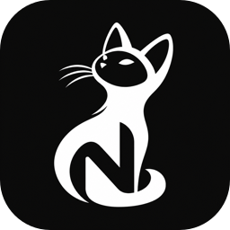

<p align="center">
  
</p>

<h1 align="center">NimoteHost — 跨平台任务、终端与编程 Agent 服务</h1>

<p align="center"><a href="README.md">English</a> · 简体中文</p>

<p align="center">
  <strong>NimoteCode 的主机端配套服务，让任务、终端和编程 Agent 会话在客户端断开后继续运行。</strong><br>
  提供独立 CLI 与桌面管理器，适用于 Linux、macOS 和 Windows。
</p>

<p align="center"><sub>持久任务&nbsp;&nbsp;•&nbsp;&nbsp;终端会话&nbsp;&nbsp;•&nbsp;&nbsp;Agent 审批&nbsp;&nbsp;•&nbsp;&nbsp;社区插件</sub></p>

<p align="center"><sub>
  <a href="#从这里开始">快速开始</a> ·
  <a href="#一键安装">安装</a> ·
  <a href="#构建与运行">源码构建</a> ·
  <a href="#fyne-桌面管理器">桌面版</a> ·
  <a href="SECURITY.zh-CN.md">安全说明</a>
</sub></p>

<p align="center"><sub>2.4.0 开发预览版 · Apache-2.0 开源</sub></p>

---

SSH 自动部署、健康检查和安全卸载见 [部署与维护指南](docs/deployment.md)。

## 项目简介

NimoteHost 主要与 [NimoteCode](https://github.com/mobiledevloperlab/nimotecode) 配合使用，
为其 Host 工作区提供任务、终端与编程 Agent 会话后端。它是通过既有认证 SSH 使用的独立 Go 服务。Host 只监听本机回环地址，
所有 RPC 请求均需认证，无需 Nimote 账号、控制面或公网中继。

提供 Linux、macOS、Windows 的 amd64/arm64 CLI 和桌面构建，以及 Linux/Windows 的
32 位 x86（386）CLI 构建。完整原生平台和移动客户端/Agent 验收仍待完成，
见[未完成功能](docs/pending.md)。

功能状态见[已完成功能](docs/completed.md)和[未完成功能](docs/pending.md)；
加固决策与验证见[加固审计](docs/host-hardening.md)和[测试记录](docs/host-hardening-tests.md)。

## 与 NimoteCode 配合，也可独立使用

在主机上安装并启动 NimoteHost，再用 NimoteCode 连接同一系统账号的 SSH，
即可使用兼容版本提供的 Host 会话、输出和 Agent 审批功能。
客户端先探测协议和能力，再启用相应功能；具体可用性取决于双方版本、主机配置和已安装的 Agent。

NimoteHost 运行不依赖 NimoteCode 客户端。其他用户可自行构建和部署，使用桌面管理器，
或从脚本、自有客户端通过以下接口接入：

- `nimotehost rpc`：从标准输入接收 JSON 请求，经主机本地认证接口调用。
- `nimotehost rpc-stream`：在单个 SSH exec 通道中复用 JSONL 请求，需先协商流协议。
- `nimotehost mcp`：供兼容 MCP 的客户端使用，默认只读；写操作需显式启用。

接口和能力见[功能与协议说明](docs/completed.md)，
版本兼容规则见[客户端兼容表](docs/host-hardening.md#client-compatibility)。
[Go 客户端包](pkg/hostclient)提供能力探测、结构化错误和基于标准输入的命令传输；
参阅[第三方接入指南](docs/client-api.md)及[可运行示例](examples/host-client/main.go)。
`pkg/pluginsdk` 用于社区插件，与通用 Host 客户端包用途不同。

Host 默认以当前系统账号执行命令。通过同一账号的普通 SSH 登录接入，相当于使用该账号的权限；
多用户部署需自行设计账号与隔离边界，参阅[安全政策](SECURITY.zh-CN.md)。

## 从这里开始

| 你想做什么 | 入口 |
| --- | --- |
| 下载 CLI 或桌面版 | [GitHub Releases](https://github.com/mobiledevloperlab/nimotehost/releases) · [平台与构建产物](#github-自动构建) |
| 安装并启动后台服务 | [一键安装](#一键安装) |
| 从源码构建 CLI | [构建与运行](#构建与运行) |
| 使用图形界面 | [Fyne 桌面管理器](#fyne-桌面管理器) |
| 了解功能与安全边界 | [已完成功能](docs/completed.md) · [安全政策](SECURITY.zh-CN.md) |

客户端断开后任务可继续运行；Host 或系统重启不会恢复任务进程。
SSH 和 Codex、Claude Code、OpenCode 等 Agent CLI 需单独安装与配置。

## 部署预编译版本

普通用户无需安装 Go。按照[已实现的安装与服务说明](docs/completed.md#installation-and-services)校验完整分发包、
复制到固定目录、配置当前用户后台服务，再通过 SSH 验证访问。

## 一键安装

在 Host 源码根目录（需 Go 1.26.5+）或已解压分发包内（无需 Go）执行：

```sh
sh scripts/install.sh
```

也可跨平台直接运行 `go run ./tools/install`（源码安装）。Windows PowerShell 使用 `.\scripts\install.ps1`。安装器校验完整包、复制到固定用户
目录、注册后台服务并确认就绪；重复执行不重启正常服务。升级保留旧包，并拒绝
中断活动任务。系统前置条件、旧预览版升级及恢复见[安装与服务说明](docs/completed.md#installation-and-services)。

## 构建与运行

一键生成当前系统的 x64（amd64）、ARM64 CLI 和 GUI，以及 Linux/Windows 的
32 位 x86 CLI，输出到项目根目录 `release/`：

```sh
./scripts/build-release.sh
# 或 make release VERSION=2.4.0
# Windows：python scripts/build-release.py --arch amd64
```

需要 Go、Python 3 和目标系统的 C 编译器/桌面 SDK。macOS 可同时编译两种架构；
Linux、Windows 的 GUI 请分别在对应架构的机器上运行 `--arch amd64` 或 `--arch arm64`。
每个版本/系统/架构/版本类型各有独立目录，包含实际二进制、相邻 `.sha1` 文件和
覆盖分发文件的 `SHA1SUMS`，同时保留原有许可证、文档和 SHA256 清单。
相同目标版本重建会替换该目录，其他已有发布目录保留。全部构建成功后才写入发布目录。

```sh
# 三平台 CLI：32 位 x86、x64、ARM64（macOS 自动跳过 386）
./scripts/build-release.sh --cli-only --os all --arch 386,amd64,arm64
# 指定版本
./scripts/build-release.sh --version 2.4.0
# 在具体分发目录内验证
shasum -a 1 -c SHA1SUMS
```

32 位 x86（386）仅提供 Linux/Windows CLI，GUI 支持 x64 和 ARM64。
`--os` 可选 `darwin`、`linux`、`windows`、`all`，其中 `all` 用于 CLI 构建。


安装 Go 1.26.5 或更高版本，克隆本仓库后，在仓库根目录执行：

```sh
go run ./tools/build
```

该命令可在 PowerShell 和 Unix Shell 中运行。生成的二进制位于
`dist/<os>-<arch>/nimotehost`；Windows 文件名为 `nimotehost.exe`。例如 Linux amd64：

```sh
./dist/linux-amd64/nimotehost start
```

指定其他目标平台和版本：

```sh
go run ./tools/build -os windows -arch arm64 -version 2.4.0
```

二进制分发包包含简短的中英文安装说明、当前平台安装脚本、许可证、模块清单、构建信息和 SHA256SUMS。
完整开发文档、贡献指南和审计记录保留在源码归档与 GitHub；打包前会检查文件清单和包内文档链接。
构建还会生成带版本的 `.tar.gz`（Linux/macOS）或 `.zip`（Windows）以及配套 `.sha256`。也可使用 Bash 包装脚本：
`./scripts/build-host.sh <os> <arch> [version]`。分发二进制时请保留整个分发目录。

将二进制放到远端用户 PATH 中的固定位置后，执行 `nimotehost install` 安装当前用户的
后台服务并等待就绪，或用 `nimotehost start` 前台运行。Host 不会配置 SSH，也不会安装第三方 Agent。
客户端断开不会停止任务；Host/系统重启会将未完成会话标记为 interrupted，不会恢复其进程。

## Windows 便携运行与安装

CLI `nimotehost.exe` 可放在任意当前用户可访问的本地目录（包括空格和中文路径），
通过 PowerShell 执行 `& 'D:\你的目录\nimotehost.exe' start`。GUI 分发包需保持 GUI 与 CLI
位于同一目录；单独下载 CLI exe 不包含图形界面，双击无参数不会启动 Host。

Windows Host 成功启动时，会在 `%APPDATA%\nimotehost\discovery.json` 自动记录当前
CLI 的绝对路径。配套新版客户端通过同一账号的 SSH 读取该文件，优先查找运行位置，
再回退到 `%LOCALAPPDATA%\NimoteHost\nimotehost.exe` 和 SSH PATH。
无需手动修改 PATH 或重启 SSH 服务；移动目录后需从新位置重新启动 Host。
已停止的 Host 仍可被发现，但客户端不会因此自动启动服务。旧客户端需要升级才能读取发现记录。

需要固定安装位置与登录启动时，从完整分发包运行 `scripts\install.ps1` 或 `nimotehost setup`；
安装需要完整包，单个 exe 的便携运行不需要安装。客户端 SSH 账号必须与运行 Host 的 Windows 账号一致。
Windows CLI 架构为 x64/amd64、ARM64/arm64 和 32 位 x86/386；GUI 当前发行目标为 amd64/arm64，
GUI 构建需要对应系统的原生工具链。发现机制不依赖 CPU 架构。

## 接口与能力

- 已认证 SSH exec：`nimotehost rpc` 或 `rpc-encoded`。
- 本地认证 HTTP RPC：任务/会话管理、终端输入与尺寸调整、按字节偏移恢复输出、持久化事件。
- stdio MCP：默认只读，写工具必须由本地操作者显式开启。
- Agent 终端适配：已安装的 Codex、Claude Code 和 OpenCode CLI；已有 app-server/ACP 结构化审批与原生历史，运行时能力和完整实机验收分别判定。

详细说明：[已完成功能与协议](docs/completed.md)、[未完成功能与验收](docs/pending.md)、
[贡献指南](CONTRIBUTING.zh-CN.md)、[安全政策](SECURITY.zh-CN.md)。

## GitHub 自动构建

[Host CI](.github/workflows/ci.yml) 在拉取请求和推送到 `master` / `main` 时，
运行测试、干净源码检查、八种 CLI 目标及六种原生桌面目标的构建。
手动运行时可选择 `cli`、`gui` 或 `both`；从运行页面的 `Artifacts` 下载构建产物。
推送 `v*` 标签后，两种构建并行启动。CLI 检查通过后先发布 CLI 包和源码归档，六个桌面构建全部
通过后再把桌面包追加到同一个 GitHub Release。追加桌面包要求仓库关闭不可变发布设置。

| 系统 | CLI | 桌面包 |
| --- | --- | --- |
| macOS | x64、ARM64 | x64、ARM64 |
| Linux | x86（386）、x64、ARM64 | x64、ARM64 |
| Windows | x86（386）、x64、ARM64 | x64、ARM64 |

桌面版使用原生运行器，附 CLI、依赖许可证和 SHA-256 校验值。Linux 桌面版要求
至少 glibc 2.35。ARM 指 ARM64，暂不提供 32 位 ARM 或 32 位桌面包。
macOS 包尚未签名或公证。发布前参阅[开源检查记录](OPEN_SOURCE_REVIEW.md)。

`amd64` 是 Intel/AMD 的 64 位 x86，`arm64` 是 64 位 ARM（包括 Apple Silicon）。
`386` 是传统 32 位 x86，仅提供 CLI；macOS 没有 32 位构建目标。
32 位 ARM 不在当前发行矩阵内。同一分发包中的 CLI 与 GUI 必须匹配目标架构。
GUI CI 配置六个具备桌面 SDK 的原生运行器；仅 CLI 交叉构建通过不代表 GUI 或交互已验收。
Windows ARM64 使用 MSYS2 CLANGARM64（`CC=clang`、`CXX=clang++`），不能复用 x64 MinGW 编译器，
参见 [MSYS2 ARM64](https://www.msys2.org/docs/arm64/)。


## Agent 上游监测

[兼容性监测工作流](.github/workflows/agent-compatibility.yml)每 6 小时运行一次
（UTC 00:23、06:23、12:23、18:23）。首次运行或上游版本变化时，临时安装指定版本的
Codex、OpenCode、Claude ACP 适配器和 Claude Code，检查真实结构化会话初始化、
运行 Host 现有 Agent/协议/审批回归测试，并导出 Codex JSON Schema；不发送提示词、不调用模型。
同时监测 Claude Agent SDK、ACP SDK 和 ACP Go SDK 的最新发布，但不会自动升级项目依赖。

推送到 GitHub 仓库的默认分支后，开启 Actions 和 Issues，在 Actions 中手动运行
`Agent compatibility monitor` 建立基线，然后订阅自动创建的 Issue。
后续版本变化和检查结果会以评论通知；邮件由 GitHub 通知设置决定。
失败的同一组版本自动重试一次，之后可手动勾选 `force` 重跑。普通无变化轮询不安装 CLI 或运行测试。
工作流无需额外密钥，使用内置 `GITHUB_TOKEN`；仅报告任务有 Issues 写权限。

检查通过只代表 Linux 上的初始化和现有模拟协议回归通过，完整审批、流式响应及恢复仍需真实模型验收。
检查失败也可能来自网络、安装或认证，需查看日志；SDK 最新版仅作为变更信号，实际检查使用
适配器解析出的依赖及仓库锁定的 Go SDK。模式定义保存为构建产物，尚未自动判断语义差异。
日志和模式定义保留 7 天。定时运行可能延迟；免费额度由账户共享，需在 GitHub Billing 中
配置 Actions 预算及超额停止，工作流本身无法保证零费用。删除 Issue 的隐藏状态会中断基线读取。

## 开发

```sh
go test -mod=readonly -race ./...
go vet ./...
```

也可使用 `make build` 和 `make check`。独立 CI 包含三平台原生检查和八目标 CLI 交叉构建。
测试不安装真实系统服务。运行时代码均位于 internal 包，外部通过版本化 RPC/MCP 接入。
模块路径为 `github.com/mobiledevloperlab/nimotehost`。

## 许可证

本独立 Host 源码树采用 [Apache-2.0](LICENSE)，版权署名为 2026 Nimote contributors。
源码从 `nimote-connect/host` 提取，Connect 基线提交为 `4701d14`。
第三方组件保留各自许可证，见[第三方声明](THIRD_PARTY_NOTICES.zh-CN.md)。许可证和上游
授权文本保留英文原文；中文说明不替代这些原文。

## Fyne 桌面管理器

命令和分发包统一命名为 `nimotehost`，GUI 显示 `NimoteHost`。
升级前先关闭旧 GUI，再从完整包运行 `nimotehost setup`。安装器通过已认证的空闲停止
迁移旧数据目录；有活动会话或新旧数据目录冲突时不会强制迁移。身份、凭证与记录保留，
安装失败时恢复旧服务。GUI 会一次性导入原语言和主题偏好。Unix 上旧 SSH 命令和
原绝对可执行路径会转到新 CLI，原二进制另存用于恢复。Windows 上手动配置的 SSH
强制命令绝对路径需改用 `nimotehost.exe`。旧拼写仅用于升级兼容。

CLI 与 GUI 复用现有 Go Host、认证本地 RPC 和三平台用户服务；Fyne 在
`cmd/nimotehost-gui` 独立模块中，CLI 不引入图形依赖。

```sh
go run ./tools/build -gui -version 2.4.0
```

需在目标系统本机构建并安装 C 编译器/桌面 SDK。产物为
`nimotehost-gui-<版本>-<系统>-<架构>.tar.gz`（Windows 为 zip），包含 CLI、
GUI、完整许可证、GUI-MODULES.json 和校验清单；原 CLI 发行包继续单独生成。
从解压包运行原安装脚本，会把整个包复制到固定目录并启动用户服务：Unix 为
`~/.local/share/nimotehost`，Windows 为 `%LOCALAPPDATA%/NimoteHost`。
随后打开安装目录中的 Windows `nimotehost-gui.exe`、macOS `NimoteHost.app`、
Linux `nimotehost-gui`。Linux 桌面入口文件要求 GUI 位于 PATH 中，或将其 Exec 字段改为绝对路径。
也可从 `dist/gui-<系统>-<架构>` 直接运行；启用登录启动后不要移动此目录。

界面保留概览、会话、设备、设置四个主要入口。首屏显示服务状态和主要操作；
会话按名称、工作区和可读状态展示，支持搜索、筛选，历史对话位于会话页的历史对话入口。
设置页按常规、本地服务和关于分组；本地服务中可直接启停 Host、编辑端口与日志级别，
采用银灰浅色与深色外观、统一圆角和间距；支持端口校验、未保存提示、撤销修改与固定保存栏。
切换界面语言会保留配置草稿和会话筛选。历史对话支持展开阅读；详情可选择、复制，诊断与日志使用大面积分页视图。
关于页说明与 NimoteCode 的分工、SSH 使用方式、本地数据、第三方 Agent 数据边界及外观。
快捷键：macOS 使用 ⌘，Windows/Linux 使用 Ctrl；1–4 切换页面、逗号打开设置、F 搜索会话、R 刷新状态。
诊断位于帮助与诊断入口；审批仍展示实际命令与文件修改。
设置页的语言选项支持英语、简体中文、西班牙语、日语、韩语和俄语，默认英语；
切换语言立即生效并持久保存，不重启 Host。Fyne 使用系统字体，Linux 的中日韩显示需安装
相应字体，例如 `fonts-noto-cjk`。
配置复用 OS 用户配置目录下的 `nimotehost/config.json`，默认 `127.0.0.1:47831`，
修改端口和日志级别前需停止 Host。GUI 语言、主题与 Linux 托盘偏好由 Fyne 单独持久化。

Host 自动解析用户 Shell 和常见安装目录，统一 Agent 检测与启动环境。
安装新工具后可运行 `nimotehost tools refresh` 重新检测，已有会话继续运行。
特殊安装位置可通过独立的 `tools.json` 指定，详见[工具发现与环境配置](docs/deployment.md#tool-discovery-and-execution-environment)。

Windows/macOS 关闭窗口隐藏到托盘；Linux 默认关闭窗口仅退出 GUI，确认有托盘支持
后可在设置启用。退出 GUI 不停止 Host、SSH 或后台任务；明确停止或重启才结束
Host 任务。完整控制仍依赖 SSH 系统账号；设备页已支持独立只读设备身份和撤销，
不自动改写 SSH 密钥。SSH 由系统管理，诊断不猜测其健康状态。
详细审计、构建依赖和限制见[已完成](docs/completed.md#desktop-architecture-audit)，
原生平台与手机验收见[待完成](docs/pending.md)。

## 设备授权

图形界面的设备页和 `nimotehost devices add <name>` 可注册独立只读设备，
`nimotehost devices list` 列出设备，`nimotehost devices revoke <id>` 撤销。
管理员须把独立 SSH 公钥绑定到 `restrict` + `device-bridge` 强制命令；
不能同时给这把密钥普通 Shell 登录权限。凭证不发送给手机，撤销针对后续 Host 请求生效。
完整 SSH/任务执行权限仍属于系统账号，不受只读设备撤销隔离。
设备注册及绑定方法、安全边界见 [设备授权说明](docs/completed.md#observer-devices-history-and-updates)。
会话页中的历史对话已接入原生历史查询与恢复；设置页可查询最新官方版本并打开下载入口。

## 社区插件

参阅[插件平台](docs/plugin-system/architecture.md)、
[公开 HCP 1.0 规范](docs/plugin-system/spec/v1/README.md)及
[SDK / HTTP API Inspector 开发安装指南](docs/plugin-system/plugin-sdk.md)。
插件默认禁用，需明确批准后启用；运行第三方程序前请阅读[安全边界](docs/plugin-system/security.md)。

同时支持本地离线包安装和 GitHub 目录搜索、下载及安装。开发者只需提交
[目录元数据](docs/plugin-system/catalog.md)，源码与发布包保留在自己的仓库中。
