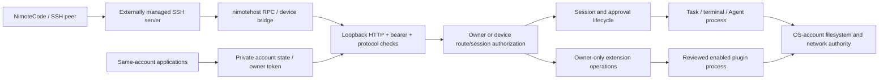

# Security and privacy audit

Baseline/date and evidence labels are defined in [AUDIT_REPORT.md](AUDIT_REPORT.md). All findings use the same IDs and priorities. This report distinguishes authorization, operating-system containment and user-visible behavior; a feature name or manifest permission is not proof of confinement.

## Verified trust boundaries

The normal deployment is a per-user service, not a privileged system daemon (`internal/hostservice/service.go:41–83`). There is no general automatic privilege drop for an operator who deliberately starts Host as root/Administrator. That increases the authority of ordinary commands and plugins. A separate Linux isolated-session facility exists and deliberately requires root, dedicated unused UIDs, private workspaces and cgroup controls (`execution_identity_linux.go:83–125`); it does not convert the entire Host or plugin daemon into a sandbox.

| Principal | Actual authority | Evidence and limit |
| --- | --- | --- |
| No bearer / unknown credential | Requests rejected before route execution. | `server.go:173–186`. Origin-bearing browser requests also fail at 167–172. |
| Owner token / unrestricted SSH account | Full exposed Host API, arbitrary tasks/terminals, plugin management, history and shutdown. | `server.go:174,218–225,312–328,368–390`; CLI reads token locally (`rpc_client.go:38–72`). An unrestricted shell already has OS-account authority. |
| `observer` | Read account session lists/output/activity/state and permitted collections. | `devices.go:271–316`; no arbitrary native Agent-history endpoint or extension access. Read-only is not privacy isolation between all sessions. |
| `session_observer` | Corresponding reads within listed session IDs; collections filtered. | `devices.go:123–145,271–290`; `server.go:234–269,342–365`. |
| `session_operator` | Scoped reads, cancel, Agent interrupt/decline, review markers; cannot approve or send general execution input. | `devices.go:279–306`; additional action restriction in `server.go:521–522`. |
| `session_controller` | Additional input/resize/control for existing sessions backed by independently checked execution identities. | `devices.go:99–110,292–300`; `server.go:227–233`; `execution_identity.go` and `execution_identity_linux.go`. Not a general portable full-shell role. |
| Enabled plugin / ordinary Agent | Native executable authority of its execution identity, normally the Host account. | `manager.go:355–411`, `plugins.go:20–66,231–244`. Same-user grants and reduced environment are disclosure/defense in depth, not syscall enforcement. |

## SSH, pairing and non-trusted devices

Verified: Host serves IPv4 loopback at a configurable unprivileged port, default 47831. Configuration does not accept a LAN bind address (`config.go:13–56`, `server.go:78–83`). There is no Host-owned public SSH listener or anonymous pairing service in the inspected server. SSH credentials, SSH server policy, mobile host-key verification and network exposure through forwarding/proxies are externally managed; their security cannot be inferred from this repository.

Registration creates a random device ID and secret and stores both a credential hash in the record and a plaintext private credential file for the forced bridge (`devices.go:147–197`). The latter is necessary for this design; hashing the record does not remove the need to protect the state directory. It is not evidence that device secrets are only hashed at rest.

`DeviceSSHCommand` produces a forced command; the administrator must actually bind a distinct key with OpenSSH restrictions (`devices.go:319–326`, `cmd/nimotehost/devices.go`). Registration does not install or remove SSH authorized keys. Revocation is read for each subsequent API request and device-bridge credential lookup (`devices.go:220–268`), including calls on a retained stream through `Call`. It cannot retract previously disclosed output or undo work already admitted.

**SEC-02 — P1, verified boundary / acceptance required.** Same-account shell access can read the owner credential and bypass device-role restrictions by acting as owner. This is the documented trust model, not a demonstrated route-authorization flaw. Minimum action: test shipped setup instructions and NimoteCode UX with both unrestricted and restricted SSH keys; accurately disclose read scope, command authority, and SSH-key removal responsibilities. Existing-user effect: no authority is silently removed; a user choosing restricted keys accepts a smaller feature set. A compromised unregistered device without SSH/owner/device credentials has no verified path to control Host through this API.

## API admission and process lifecycle

Verified protections include constant-time owner-token/hash comparison, exact protocol check, owner-only plugin endpoint, JSON unknown-field rejection and a single JSON value (`server.go:33–42,167–233`), 1 MiB body bounds (`server.go:645–661`), HTTP deadlines/header limits (`server.go:126`), bounded connections, global and per-principal admission (`server.go:82,192–216`, `admission.go`), eight RPC stream workers and duplicate in-flight request IDs (`rpc_stream.go:52–107`). `rpc_client.go:29,80–89` disables proxies/redirects for loopback and bounds its response to 2 MiB.

Session IDs are validated before filesystem access (`manager.go:180–192`, `server.go:396–400`). Command execution passes explicit argv with `exec.Command`, rather than concatenating a remote string into a shell (`manager.go:355`). Terminals intentionally run shells, and an authorized task can intentionally execute `sh -c`; this API is a remote execution feature, not a command allowlist.

Disconnecting the SSH bridge detaches it; background processes belong to Manager (`rpc_stream.go:15–19`). Server startup acquires a state lock and listener before recovering sessions (`server.go:60–96`). Shutdown closes the HTTP server and Manager/plugin resources (`server.go:100–140`). Unix uses process supervision/groups and optional cgroups; Windows uses Jobs/ConPTY (`supervisor_unix.go`, `platform_windows.go:91–120`). macOS cannot provide the Linux cgroup guarantees. Persisted interrupted records do not mean an OS process survived daemon restart (`protocol.go:44`, `manager.go:109–172`).

**SEC-05 — P2, verified resource limitation.** Defaults are 32 active and 256 retained sessions, 64 MiB minimum free disk, unlimited runtime and no configured hard CPU/RSS/process quotas (`resources.go:16–32`). Resource monitor cancels sessions on runtime/disk/output failure (`resources.go:80–125`). Plugin launch receives native limits, but a same-account plugin can allocate files or fork outside portable hard guarantees. Minimum action: document optional resource settings and use `Capabilities.Enforcement`, not an unconditional sandbox claim (`resource_capabilities.go:13–28`, `resource_caps_linux.go:12–27`, `resource_caps_darwin.go:6–9`). Existing-user effect: preserve long-running workloads; do not impose finite runtime defaults without an explicit migration choice.

## Agent tools, approvals and external attachment

Verified: native Codex/ACP requests are projected through existing state machines and the SDK transport (`agent_rpc.go:23–49,152–208`). Approval context must match active work/thread/turn when supplied; outstanding handlers are rejected at turn completion (`agent_permissions.go:6–28,53–66`). ACP one-time decisions are validated rather than silently turning permanent permissions into one-time ones (`acp_agent.go:205–245`; related tests in `hardening_approvals_test.go`, `acp_agent_test.go`).

Execution policy defaults to `confirm`; `smart` and `auto` require explicit policy selection, and external attachments require confirm (`agent_execution_policy.go:15–25,43–69`; `manager.go:194–209`). Smart approvals check restricted command forms, workspace paths and symlink resolution (`agent_execution_policy.go:129–215,260–425`). These checks classify provider requests; they do not sandbox a malicious Agent process or verify its declared tool metadata against kernel activity.

Codex startup retains provider approval/sandbox configuration (`codex_agent.go:142–149`). Consequently Host confirm mode means “do not automatically answer the approval requests Host receives”; it cannot promise that a provider configured for unrestricted execution will emit every potentially sensitive action. `agent_structured_approval` is conservatively false in base features (`protocol.go:44`), despite structured request handling existing. Do not change it to true solely because the UI can display approvals. **SEC-02 acceptance** must verify provider-specific behavior and explain terminal fallback, provider settings and detached auto approvals. Existing-user effect: retain existing configured behavior; clarify the limits before promising universal confirmation.

External OpenCode endpoints require literal loopback IPs and unprivileged ports; credentials are POST-body data rather than query/argv/session fields (`external_attachment.go:15–65`). HTTP uses no proxy/redirect and bounded time/body, and hides provider error bodies (`opencode_attachment.go:29–95`). Codex Unix sockets require ownership and non-writable owner-controlled directories (`codex_socket_security_unix.go:13–48`); Windows has its own pipe checks. These services remain trusted local peers after validation. Endpoint validation does not cryptographically identify an arbitrary loopback service; owner-specified service authenticity remains an operational assumption, not a demonstrated exploit. Live attachments own subscriptions, not the provider process (`opencode_attachment.go:163–164`).

MCP is stdio and read-only by default; writes require `NIMOTEHOST_MCP_WRITE=1` (`cmd/nimotehost/main.go:82–83`). Tool handlers still go through authenticated Host RPC and a fixed operation allowlist (`mcp.go:23–54,102–126`). A client holding owner authority can set a confirmation boolean; the wire cannot prove a human clicked. This limitation also applies to extension invocation and must be reflected in trusted-client UX.

## Plugin boundary

Verified: HCP operations require owner authority before dispatch (`server.go:218–225`); manifest permissions reject unknown names and require `process.same-user` (`pkg/pluginsdk/protocol.go:69–82`). Installation requires reviewed hashes and regular bounded files; enabled grants must match the manifest; plugin input/output schemas and frames are bounded (`internal/plugins/runtime.go:146–211,246–270,497–610,649–684`). Schema references are rejected to avoid implicit URL/file resolution (`schema.go:11–51`). Runtime errors and raw stderr are sanitized/discarded (`plugins.go:33–34`, `runtime.go:598–607`).

A plugin can still read the token, projects or other accessible files, open arbitrary network connections, and alter Host state using ordinary OS APIs. Absence of `network.public` is not a firewall. The public-HTTP helper implements its own checks (`pkg/pluginsdk/publichttp/network.go`), but arbitrary third-party code need not call it. Thus plugins can bypass API-level restrictions **after the owner authorizes same-account code execution**. This is disclosed in `docs/plugin-system/security.md:3–18`, not a new unauthenticated escalation. No portable in-process permission list can fix it. The minimal supported recommendation is reviewed code and a separately confined account/VM for hostile workloads, not adding a second plugin framework.

Catalog retrieval is explicit, HTTPS/GitHub-restricted and public-address checked, without proxy/token inheritance (`internal/plugins/catalog.go:84–120,240–288`; `pkg/pluginsdk/publichttp/network.go`). Checksums pin reviewed bytes; they do not authenticate the author's intentions. The full malicious-source/TOCTOU/network-routing threat model was not penetration-tested here.

## Data inventory and privacy

| Data class | Actual storage/flow | Exposure and retention |
| --- | --- | --- |
| Owner token and host ID | Random 32-byte values encoded as hex; private files under OS config `nimotehost` (`storage.go:17–42,96–138`). | Plaintext local files; no per-device isolation from unrestricted same-account execution. Host ID is a stable identifier exposed to authorized clients. |
| Device records/secrets | `.json` credential hash, role/scopes, private `.credential` (`devices.go:180–197`). | Revocation marks records; it does not erase SSH keys or copies/backups. |
| Sessions/output | Command, argv, working directory, error and conversation metadata; 16 MiB output ring per retained session (`protocol.go:75–100`, `output.go:19–68`). | Can contain secrets/prompts/code. Session retention is capacity-based, not a default time expiry; 256 full rings are roughly 4 GiB before other data. |
| Activity/verification/task data | Tool/approval activity, summaries, edits/diffs, verification records and GitHub task bodies (`activity.go:193–212`, `verification.go`, `github_tasks.go:24–60`). | Sensitive user content, not just operational metadata. Treat exported snapshots and backup directories accordingly. |
| Mutation receipts | Payload fingerprint and result/error, not a raw copy of every submitted payload (`idempotency.go:73–145` and later persistence). | Results may include session metadata; expiring keys retire after seven days, legacy records intentionally do not (`request_retention.go:15–34,47–98`). |
| Operational log | Private `host.log`, 64 KiB rolling limit (`log.go:12–65`); SDK raw logging suppressed (`agent_rpc.go:38–39`). | Error strings may contain paths. Bounded size and suppressed protocol logs do not imply arbitrary execution output is redacted. |
| Outbound data | User-requested GitHub operations via local `gh`, Agent-native provider/network behavior, explicit catalog/download/version checks (`github_tasks.go:97–123`, `desktop/releases.go:21–54`). | Prompts/code may leave the machine through the selected Agent. No Host telemetry uploader was identified in inspected runtime paths; that does not characterize third-party executables. |

Unix state checks enforce ownership/private modes and reject symlink roots; Windows sets protected owner DACLs (`storage.go:45–59`, `platform_unix.go:21–29`, `platform_windows.go:26–45`). Private files and atomic writes reduce other-user access and torn state. They do not defend against root/Administrator, same-account malware, arbitrary ancestor-path manipulation or full-disk backup disclosure. Windows race/ACL behavior still needs native acceptance.

**SEC-01 — P1, local credential risk.** Ignored `env.md:2–5,9–12,16` contains login information and an API-key-shaped value. No values are reproduced. `.gitignore:20` excludes it, and the export allowlist excludes that root file. Current tracked content and scanned reachable history did not establish publication. Minimum action: owner confirms validity and any external exposure, rotates real credentials, and keeps the note outside publication material. This audit did not test logins or contact the credential provider. Existing-user effect is limited to any affected credential configuration.

**SEC-03 — P2, owner-credential recovery.** `loadSecret` keeps an existing valid token; no dedicated rotation CLI was found (`storage.go:96–138`, CLI dispatch). Minimum action: document rotation only while stopped with existing state locks, and reconnect bridges afterwards; a future small command may automate that procedure. Do not delete unrelated state or assume replacing the file revokes an already-running daemon's cached token. Existing-user effect: intentional authentication interruption during rotation.

**SEC-04 — P2, retention and partial deletion.** Raw argv/output cannot safely be universally scrubbed without breaking function. Minimum action is an accurate local-data inventory, opt-in cleanup and retryable orphan-file deletion. `manager.go:762–774` removes session metadata before later auxiliary files; a later failure leaves remnants absent from the live session map. Reorder or journal the minimal cleanup and expose a stopped-state retry mechanism. Keep old receipt anti-replay guarantees intact. User effect: improved privacy/recovery, no required protocol change. This is not a proven credential exfiltration path.

## Known-vulnerable desktop dependencies (REL-03)

**Conclusion:** affected versions and static call paths are verified; attacker-controlled input reachability needs further verification. **Priority:** P1 for desktop release triage. **Existing-user effect:** no protocol change; a dependency update needs native GUI/rendering regression checks.

The final, fully collected `govulncheck v1.9.0 -json ./...` outputs on Go 1.27.4/macOS arm64 show no CLI findings and **50 desktop finding records representing 30 advisory IDs**. Six records include vulnerable-symbol traces across the four TIFF advisories below; other records describe affected modules/packages without a vulnerable-symbol call trace. A JSON-mode exit status of zero must not be interpreted as a clean security result.

| Advisory | Affected current dependency / upstream fixed version | Static evidence and risk |
| --- | --- | --- |
| [GO-2026-4815](https://pkg.go.dev/vuln/GO-2026-4815) | `golang.org/x/image v0.24.0`; fixed in `v0.38.0` | Decoder/DecodeConfig traces through Fyne image sizing and icon loading. A malformed TIFF can cause excessive allocation. |
| [GO-2026-5032](https://pkg.go.dev/vuln/GO-2026-5032) | Same current module; fixed in `v0.41.0` | Decode trace through Fyne icon loading; excessive PackBits decompression work. |
| [GO-2026-5062](https://pkg.go.dev/vuln/GO-2026-5062) | Same current module; fixed in `v0.43.0` | Decode trace; TIFF tile sizes can cause unbounded allocation. |
| [GO-2026-5066](https://pkg.go.dev/vuln/GO-2026-5066) | Same current module; fixed in `v0.43.0` | Decode trace; invalid TIFF strip offsets can panic. |

Repository evidence: `cmd/nimotehost-gui/go.mod:49–50` pins old x/image/x/net; `go.mod:10` in that same nested module pins x/text. The reported path is `main.go:35–41` → `window.go:55–67` → Fyne `internal/driver/glfw/window_desktop.go:254` / `canvas/image.go:377` → standard image dispatch → TIFF decoder. Current application icon/sidebar resources come from embedded PNGs (`branding.go:11–27`). The inspected GUI content paths use text segments rather than arbitrary remote images (`history.go:368–382`, `text_pager.go:35–52`); no remote TIFF input path was established. Generic image dispatch makes a symbol statically reachable even when the actual image is a fixed PNG. Therefore this is **not a demonstrated remote GUI denial-of-service exploit**.

The remaining 26 advisory IDs concern versions of x/image, x/net or x/text without vulnerable-symbol traces in this target. Absence of a symbol trace is useful triage evidence, not a cross-platform safety guarantee. The complete ID/fixed-version summary is recorded in the license report. No malformed-image exploit was run, and no dependency was changed.

Minimum action: prefer a narrowly scoped compatible update of affected desktop dependencies, followed by existing headless/native GUI and license-collection checks. Alternatively, document a concrete non-exposure decision with evidence for all affected input paths and review it when adding image/HTML/font features. Choose update versions only after verifying their Go/toolchain requirements and transitive changes. Keep module/package-only matches separate from actual vulnerable call paths, and rerun for release-target imports and the build toolchain.

## Further verification required

COMP-01/P1: NimoteCode must validate size/depth/types/enums, tolerate unknown capability/UI kinds safely, render text/control characters safely, and obtain genuine user consent before owner calls. Host-side schema validation cannot protect a phone from a deliberately modified Host that bypasses that validation. Test both direct responses and stream framing; do not infer Flutter behavior from Host docs.

REL-01/P1: exercise actual Windows ACL/ConPTY/Jobs, Linux cgroup/UID/seccomp constraints and all supported native builds. REL-03/P1: close the desktop dependency triage above and check actual release toolchains/target-specific imports. SSH host-key pinning, unrestricted-key policy, production network forwarding and credential validity remain outside this code-only audit.

These checks should close targeted release gates. They do not justify adding general-purpose sandbox provisioning, per-device execution simulation inside one UID, a policy DSL or new public API transport.
