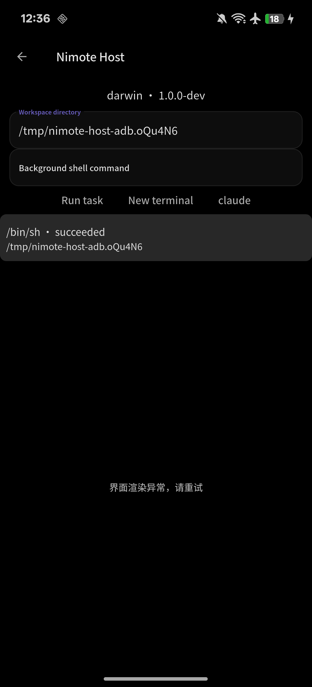
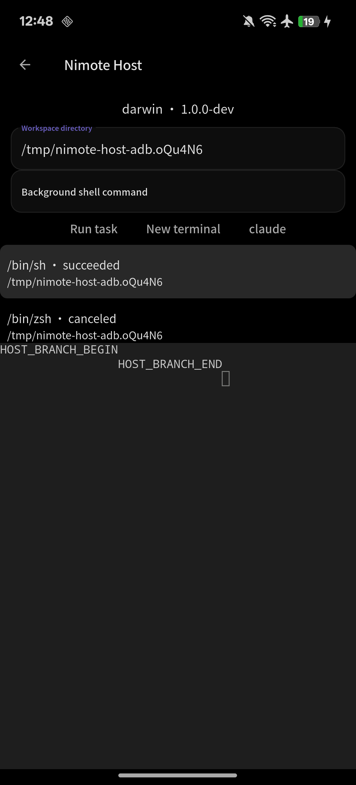
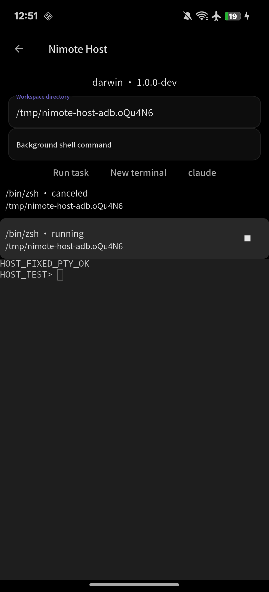

# Host Android ADB 与 macOS 实机测试记录

日期：2026-11-13。环境配置从根目录 `env.md` 读取；本文按机器角色记录，不包含地址、
用户名、密码、token 或 API Key。`env.md` 已加入本地忽略规则，不纳入提交或公开源码包。

> 后续已复用手机保存的 Windows / WSL2 连接完成补测，修正了本阶段环境参数导致的
> 连接限制结论。请同时阅读[Windows / WSL2 补测记录](host-win-wsl-adb-validation-2026-11-13.md)。

## 测试对象与边界

- Host：本仓库的 `1.0.0-dev` darwin/arm64 二进制，临时部署到 macOS 26.2。
- 手机：PKG110，Android 16 / API 36；ADB 显示两个通道，核对序列号后确认是同一台设备。
  本次只使用一个通道，不能当作双设备验收。
- **客户端：`/home2/nimotecode` 的 `nimote-host` 分支，基线 `4ddb16ac9`。**
  此分支包含 `lib/host/host_client.dart`、`host_panel.dart` 及 Tasks 的 Host 入口。
  `master` 上安装版的 SSH 终端结果仅用于先行连通性检查，不替代专用分支测试。
- 在独立工作树构建 `com.nimote.nimotecode.prootqa`、2.3.0+62 的 arm64 debug APK。
  保留了原 `com.nimote.nimotecode` 2.3.0+63 及其数据，没有覆盖原安装版。
- 复用了现有 Android 原生库和运行时资源；未全量重新编译 Rust。基线分支与 master 的
  Rust 源码无差异，但这不等于本轮独立验证了全部原生产物来源。
- macOS 使用用户级临时二进制和临时 PATH 符号链接，未注册 launchd 或修改 SSH 配置。
  第一次连接使用隔离的已知主机记录保存首次信任结果，不宣称进行了独立带外身份认证。
- 只运行 Claude Code `--version`，没有发起模型对话；`env.md` 中 AI API Key 未用于请求。

## 环境连接结果

| 角色 | 结果 | 对后续测试的影响 |
| --- | --- | --- |
| macOS | SSH 认证成功；Darwin arm64、macOS 26.2；Host protocol 1 | 用作实际 Host 目标 |
| Linux/WSL2 | 初次 TCP 拒绝；后续可达，但提供的凭据认证返回 AuthenticationException | 未在此目标部署或执行 Host |
| Windows | TCP 曾短暂可达；SSH 连接及后续探测为连接拒绝 | 未进行 Windows 原生验证 |

未反复尝试密码、绕过主机密钥冲突或修改网络/认证设置。上表反映本次环境状态，不证明
Windows/WSL2 平台的 Host 实现存在缺陷。

## 构建与客户端自动检查

在独立工作树中执行以下流程，主工作区继续停留在 master，原有未跟踪环境文件保留：

```sh
flutter pub get --offline
env 'ORG_GRADLE_PROJECT_proot-central-qa=true' \
  flutter build apk --debug --target-platform android-arm64 --no-pub
flutter test --no-pub test/host
```

首次构建因工作树缺少被忽略的 `rust/vendor/openai-codex/LICENSE` 和 NOTICE 资源失败，
从现有工程复制对应资源后构建成功，未改动产品逻辑来绕过构建。首次本地 Flutter 测试
出现 WebSocket upgrade 错误，清除代理变量、为 localhost 设置 NO_PROXY 后重跑通过。

- 修复前 HostClient：5 项通过，包括能力隔离、缺失/不兼容回退、安全参数、偏移和大输入分片。
- 修复后 Host + 终端输入组合检查：53 项通过。
- 聚焦静态分析：Host、Tasks 入口、Host 测试与修改的 xterm 文件通过。
- APK 通过独立 applicationId 校验后安装；手机安装确认由设备所有者完成，没有读取或记录
  锁屏密码。

修复前 APK SHA256：

```text
531a68bb256c3bc0166c696a8d564ff42201bb6336d66d150dc0c0d457188733
```

修复后的提交和 APK 校验信息见本文末尾最终核对项。

## macOS 原生 Host 实测

| 用例 | 结果 | 核对方式 |
| --- | --- | --- |
| version / capabilities | PASS | version 为 1.0.0-dev，platform=darwin、arch=arm64、protocol=1 |
| 成功任务 | PASS | 输出标记正确，succeeded / exit_code=0 |
| 失败任务 | PASS | failed / exit_code=7 |
| 输出按偏移恢复 | PASS | 从 next_offset 再读无重复字节 |
| 原生 PTY 输入、resize、取消 | PASS | 输入标记可读；40×120 resize 成功；取消后 canceled |
| 持久化事件 | PASS | 能查询到本次会话状态事件与有效 cursor |
| 匿名请求 | PASS | 无 token 的 status 请求返回 401 |
| Claude Code 启动入口 | PASS | 2.1.268 (Claude Code) 的 --version 成功 |
| Host 重启后身份与记录 | PASS | Host ID 不变，旧成功/取消记录可读取 |

这里的原生 PTY 验证不是 launchd 服务生命周期验收，也不是 Agent 真实对话/审批验收。

## 手机专用 Host 面板实测（修复前）

路径：Full IDE → Connect Remote Workspace → 测试目录 → Explore → Tasks → Nimote Host。
连接密码通过环境文件在内存读取并输入，未设置记住密码。

| 用例 | 结果 | 实测观察 |
| --- | --- | --- |
| 专用入口与能力探测 | PASS | 面板显示 darwin · 1.0.0-dev，提供运行任务、新终端和 claude 入口 |
| 手机创建后台任务 | PASS | 面板提交 `echo HOST_BRANCH_BEGIN; sleep 60; echo HOST_BRANCH_END`，服务端记录 running |
| App 被终止后任务继续 | PASS | 对测试包执行 am force-stop 后，服务端任务仍 running，随后 succeeded/0 |
| App 重连后列出同一任务 | PASS | 重新输入 SSH 密码后，面板显示原任务 succeeded |
| 后端输出保留 | PASS | 认证 SSH RPC 能读取 BEGIN/END 两个标记 |
| 手机任务输出显示 | FAIL | 终端区域显示“界面渲染异常，请重试”，选择已有任务仍不能显示输出 |
| 手机新建终端/取消 | PASS | 手机创建的 /bin/zsh 会话在服务端运行，通过面板取消后 canceled |
| 手机终端交互输入 | BLOCKED | 被上述渲染异常阻断，未将原生 PTY 的结果冒充手机结果 |
| Host 离线提示 | PASS | 停止临时 Host 后，面板显示 Host unavailable；没有自动安装或启动 Host |

修复前现场截图（仅含临时工作目录和测试状态，无认证信息）：



## 发现的问题与修复

### 1. 只读终端重建时触发构建期 setState

日志关键内容：

```text
setState() or markNeedsBuild() called during build.
TerminalViewState._onComposing
CustomTextEditState._resetLocalEditingState
CustomTextEditState._closeInputConnectionIfNeeded
CustomTextEditState.didUpdateWidget
A GlobalKey was used multiple times inside one widget's child list.
```

只读输出页轮询重建时，子输入组件清空组合状态，同步通知父 TerminalView 执行 setState，
随后出现 GlobalKey 错误级联。修复 `third_party/xterm/lib/src/terminal_view.dart`：
忽略未变化的组合文本；在构建阶段将变化合并到帧结束后处理，并检查 mounted。
没有隐藏 FlutterError，也没有用替代错误页掩盖异常。

新增两项回归：只读页反复重建、IME 组合输入中切换只读。使用未修复文件运行时两项失败，
恢复修复后通过；既有终端输入测试同时通过。

### 2. 对任务/已结束会话发送 resize

第一轮渲染修复后的实机复测暴露了第二个问题：选择成功任务时仍向其发送终端 resize，
服务端返回 `session has no active terminal`，客户端清空能力缓存，页面短暂出现 `null · null`。

修复 `lib/host/host_panel.dart`：输入和 resize 只允许当前选中的、仍在运行的交互终端；
发送队列中的输入也在实际发送前复核。新创建记录先加入本地列表，再进行首次终端布局。
新增面板组件测试，验证成功任务/取消终端只回放输出、不发送输入或 resize；运行终端在
结束前接受操作，结束后不再发送操作。为测试注入可选客户端，正常入口仍捕获当前 SSH scope。

完整验证结果不应解读为稳定 1.0、三平台服务、SFTP/Git/IDE 全回归或多手机接管已验收。

## 最终实机复测与交付

客户端修复已提交到 **NimoteCode 的 `nimote-host` 分支**：

```text
b3a709db538a9eb5fe452ef9e863386e7e7ae58c
fix(host): stabilize terminal rendering and guard inactive session input
```

原 `/home2/nimotecode` 工作区仍是 master，没有合并或覆盖其内容。修复位于独立工作树，
没有推送远端。最终测试 APK 位于本仓库本地忽略目录 `dist/qa/nimotecode-host-arm64-debug.apk`。
这是客户端测试 APK，不是独立 Go Host 的公开发行包。

最终 APK SHA256：

```text
a17f5071f77a69737388ecd2fc1b657c4530b0354893c2b6939179f3419a875e
```

| 修复后实机用例 | 结果 | 观察与证据 |
| --- | --- | --- |
| 成功任务输出回放 | PASS | 选择旧任务后可见 HOST_BRANCH_BEGIN / HOST_BRANCH_END，原渲染错误消失 |
| 选择成功任务时的能力栏 | PASS | 保持 darwin · 1.0.0-dev，不再出现任务 resize 引起的 null · null |
| 手机交互终端输入 | PASS | 手机输入 echo，服务端 PTY 输出确认有独立 HOST_FIXED_PTY_OK 行，而非只有输入回显 |
| 关闭面板并重新附着终端 | PASS | 重新选择仍运行的终端，可恢复输出，再执行 HOST_REATTACH_OK 命令成功 |
| 手机取消终端 | PASS | 面板取消后服务端状态 canceled，页面仍正常 |
| Host 离线回退提示 | PASS | 再次停止 Host 后显示不可用提示，没有重新出现渲染异常 |
| 当前测试进程的渲染日志 | PASS | 观察期间构建期 setState、重复 GlobalKey、RenderFlex overflow 三类计数均为 0 |
| 普通 SSH 终端在 Host 停止时执行命令 | 未确认 | 终端页可打开；ADB 自动注入命令出现截断，未取得目标测试文件回执，重试短命令亦未确认，不记为通过 |

最后一项未确认不等同于已证明 Host 破坏 SSH：尚需用实际软键盘区分旧客户端输入行为与
ADB 硬件按键注入的差异。没有将进入页面或看到输入回显当作执行成功。SFTP、Git、IDE
等原功能也未做全量设备回归，仍是后续工作。

修复后的任务输出与终端重新附着截图：





复测时，PTY 原始输出含 ANSI 控制序列和 CR/CRLF。命令结果在去除控制序列后按独立行
核对，不能把一次原始字符串正则不匹配当作命令未执行，也不能把命令自身回显当作执行成功。

### 环境收尾

- 已停止测试 Host、清理临时 PATH 链接和远端测试目录。
- 已核对 Host 身份及测试记录归属，再删除本轮首次创建的 Host 状态目录；没有删除原有
  用户 Host 状态，没有安装或卸载已有系统服务。
- 手机保留独立修复版测试包，已 force-stop 关闭本轮连接；原安装版保留。测试连接历史
  可用于复测，密码未保存。复测前需重新部署长期使用的 Host，临时二进制已清理。
- 独立构建工作树中临时复制的签名配置已移除，原工程的签名配置未变。
- 设备临时 UI XML/截图已清理。报告只保留不含认证信息的 Host 面板截图。
- [结构化脱敏证据](../audits/evidence/host-adb-2026-11-13.json)记录环境角色、校验信息和
  修复前后状态；不包含原始设备序列号、地址、账号、密码、Host token 或模型密钥。

### 尚未覆盖

Windows/WSL2 目标受本次连接/认证条件限制；macOS launchd 真服务生命周期、真实付费
Agent 对话与审批、双手机接管、完整 SSH/SFTP/Git/IDE 回归均未验收。后续修复应继续在
专门的客户端分支验证，不能用 master 安装版替代，也不能将本报告写成完整 1.0 发布通过。
