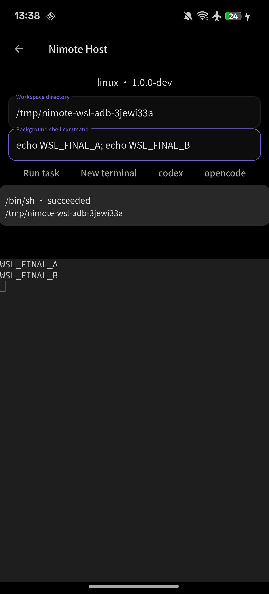

# Host Windows / WSL2 与 Android 补测记录

日期：2026-11-13。本轮直接使用手机已保存的 `win`、`wsl2` 连接记录；没有改写连接、
保存密码或覆盖原安装版。认证信息只在内存中读取根目录 `env.md`，不随文档提交。

## 环境与前次结论修正

- 手机仍为 PKG110、Android 16 / API 36；使用独立 QA 包
  `com.nimote.nimotecode.prootqa`，不是 master 安装版。
- 客户端在独立工作树使用 `nimote-host` 分支。前次页面修复为 `b3a709db5`，
  本轮 Windows 适配与任务换行修复为 `c5d78641e`，未推送或合并到 master。
- Windows 为 NT 10.0.26200.0 / x64，WSL2 为 Linux / amd64；Host 为 `1.0.0-dev`、协议 1。
- WSL2 保存记录的用户名与环境文件不同，采用保存记录后可正常认证；核对后发现当前
  执行环境与目标 WSL2 属于同一内核实例，后续原生检查在该实例执行。
- 测试控制端通过 Windows 回环 SSH 访问成功；手机继续使用其原保存地址，连接成功。
  前次报告中的 Windows 拒绝连接、WSL2 认证失败只反映当时参数，不能解释为 Host 不支持。
- 使用临时用户级二进制及已有 PATH 目录，不修改 PATH、SSH、防火墙或系统服务。
  Windows Host 由独立控制端 SSH 通道保持前台运行，WSL2 使用独立前台进程。
  因此下述“断线”指手机 App 断开，不代表控制通道退出、用户注销或操作系统重启。

## 原生 Host 验证

| 用例 | WSL2 | Windows |
| --- | --- | --- |
| 普通任务、成功状态与退出码 0 | PASS | PASS |
| 失败任务与退出码 7 | PASS | PASS |
| 输出 offset 增量读取且不重复 | PASS | PASS |
| PTY / ConPTY 输入、resize、取消 | PASS | PASS（修复后） |
| 持久化事件读取 | PASS | PASS |
| Job Object 取消时终止子进程 | 未单独验证 | PASS |
| 中文且含空格的工作目录 | 未单独验证 | PASS |
| 未认证 HTTP 请求返回 401 | 本轮未重复 | PASS |
| Agent CLI 发现 / --version | codex 0.167.0、opencode 1.18.30 | 本机未安装，不强行安装 |
| Windows batch 包装器原生回归 | 不适用 | PASS |

Windows 测试二进制在真实 Windows 执行 `TestWindowsConPTYReconnect` 和
`TestWindowsBatchLauncher`，两项通过。ConPTY 回归先空闲 1.2 秒确认 shell 仍 running，
再写入命令、等待结束并核对输出，覆盖 SSH 重定向输入下的提前退出问题。

## 手机保存连接与 Host 面板验证

| 用例 | WSL2 | Windows |
| --- | --- | --- |
| 复用保存记录进入工作区 | PASS | PASS |
| 面板显示正确平台及 Host 版本 | PASS | PASS（修复后） |
| 手机创建后台任务 | PASS | PASS |
| force-stop QA 后任务继续运行 | PASS | PASS |
| 重开 QA、复用记录、恢复同一任务 | PASS | PASS |
| 完成状态 succeeded/0、BEGIN/END 输出恢复 | PASS | PASS |
| 手机交互终端实际执行 echo 标记 | PASS | PASS（修复后） |
| 手机取消交互终端 | PASS | PASS |
| 停止 Host 后面板提示不可用 | PASS | PASS |

通过服务端状态与输出核对任务存活及终端命令执行；不能把进入终端或看到输入回显当作
执行成功。PTY 输出去除 ANSI 控制序列并按独立输出行核对。Windows 输入走逐条 RPC
队列，ADB 连续输入后需等待队列排空，不能立即读取一次就判断失败。

Windows 手机默认终端实际为 PowerShell；原生 ConPTY 测试使用 cmd.exe，两者均验证。
保存的 Windows SFTP 根目录采用 `/D:` 形式，新建终端后服务端取得原生盘符绝对目录，
没有改写保存记录。Windows 截图含用户目录，本报告不公开原始截图。

最终 APK 另行复测了 WSL2 结构化 RPC、任务输出及 LF 左对齐：

## 本轮发现与修复

1. **Windows Host 调用不符合现有执行器契约。** 原客户端将 RPC 拼成普通命令字符串，
   Windows 原生执行器拒绝 POSIX 形式的未结构化命令。改为已有的
   `__NIMOTE_REMOTE_PROCESS__` argv 封装，继续使用已认证 SSH scope；不新增 shell
   拼接、命令重试或认证路径。Unix 共用同一结构化契约。
2. **Windows SFTP 目录不是原生绝对路径。** `/D:`、`/D:/folder` 在 Windows 创建请求
   中分别转成 `D:/`、`D:/folder`；Unix、原生目录、UNC 保持原有语义，不猜测相对路径。
3. **ConPTY shell 立即退出。** 子进程启动时显式设置 `STARTF_USESTDHANDLES` 并提供
   空标准句柄，使 ConPTY 初始化其控制台输入输出，避免沿用 SSH 父进程重定向输入。
   Job Object 进程树管理保持有效；修复后真实 Windows 输入、resize、取消和子进程清理通过。
4. **普通任务的 LF 输出列位置错位。** Task 使用普通管道，没有 PTY 的换行处理；
   为 task 回放启用终端 LF 换行归零模式，交互终端继续保留原生控制序列行为。
   新增组件回归核对两行 LF 文本左对齐，避免只修复异常页而遗留输出错位。

ConPTY 生命周期参考 [Microsoft 官方文档](https://learn.microsoft.com/en-us/windows/console/creating-a-pseudoconsole-session)。

## 代码与构建验证

- 客户端：56 项 Host / 终端输入测试通过；`flutter analyze --no-pub lib/host test/host`
  无问题；arm64 debug APK 构建成功。
- Host：`go test ./...`、`go test -race ./...`、`go vet ./...` 通过；Windows amd64
  分发二进制与归档重新构建成功；Windows 原生测试不以交叉编译代替。
- 最终客户端 APK 保存在本地忽略目录 `dist/qa/nimotecode-host-arm64-debug.apk`，
  SHA256：`e8f916bd5351acc1298022b996387c71ea3521f8c91ec75565b99199ab3096d3`。
  已安装到 QA 包，原 app 与保存连接数据保留。

## 验收边界

本轮没有安装 systemd user / Task Scheduler 服务，不代表服务安装、重启、卸载、
用户注销后继续运行已验收。Windows 与 WSL2 镜像网络共用端口资源，切换测试时发现
Windows TIME_WAIT 尚未释放会暂时阻止 WSL2 绑定同一端口；本轮没有更改网络配置。

没有发起付费模型请求；CLI --version 不是 Agent 对话、审批或跨手机接管验收。
完整 SSH / SFTP / Git / IDE 回归、双设备接管和正式 1.0 发布门禁仍待执行。

## 收尾与证据

- 最终 APK 的 WSL2 结构化请求、终端输入与取消复测通过；当前 QA 进程日志中，
  构建期 setState、重复 GlobalKey、RenderFlex overflow 三类异常计数均为 0。
- 已停止两平台测试 Host；核对 Host ID、空会话目录及二进制归属后，清理本轮首次创建的
  Host 状态、临时 PATH 文件/链接及测试目录，没有删除原有用户状态或更改系统服务。
- QA 包保留并已关闭，保存连接未改动；原 NimoteCode master 工作区未切换，原安装版保留。
  独立工作树的临时签名配置与设备 UI XML 已移除。再次实测需要先按部署教程启动 Host。
- [结构化脱敏结果](../audits/evidence/host-win-wsl-adb-2026-11-13.json)包含分平台结果、
  客户端提交、APK 校验和与验收边界，不包含地址、账号、密码、Host token 或模型密钥。
